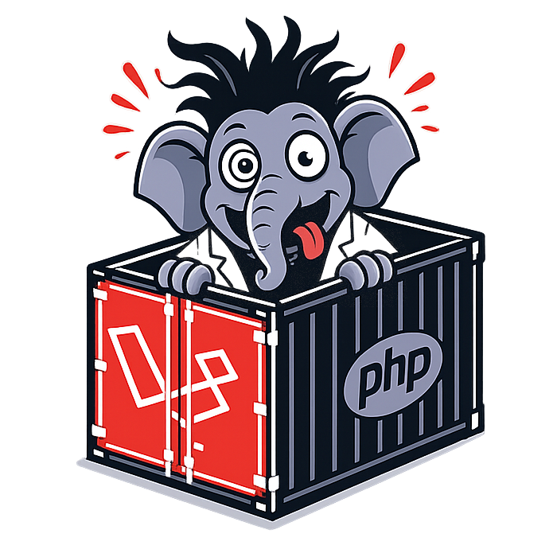

<p align="center">
      
</p>

<h1 align="center">
    <span style="color: #f44336;"><</span>
Laravel
Lo.
Co.
<span style="color: #f44336;">/></span>
</h1>

<p align="center"><span style="color: #f44336;">Local Container</span> for Laravel development.</p>
<p align="center"><em>- A simply approach. -</em></p>

<p align="center">
  <a href="https://github.com/andrea-lorusso/laravel-loco/blob/main/LICENSE" title="Licence"></a>
  <a href="https://laravel.com/" title="Laravel">
  </a>
  <a href="https://github.com/andrea-lorusso/laravel-loco/releases/" title="Releases">
    
  </a>
  <a href="https://github.com/andrea-lorusso/laravel-loco/issues/" title="Issues">
    
  </a>
</p>

---

# What this is

A ready-to-use [Dev Containers](https://containers.dev/) setup for local Laravel development: nginx (HTTPS via a self-signed certificate), PHP-FPM 8.3 with Node.js, MySQL 8.0 and Redis, all wired together automatically. This repository ships **no Laravel application code** — on first boot it scaffolds a fresh `laravel/laravel` install for you and connects it to the containers, so you (or whoever forks this) always start from the latest Laravel release.

# Prerequisites

- [Docker Desktop](https://www.docker.com/products/docker-desktop/) (or an equivalent Docker Engine) running locally
- [Visual Studio Code](https://code.visualstudio.com/) with the [Dev Containers](https://marketplace.visualstudio.com/items?itemName=ms-vscode-remote.remote-containers) extension
- An `~/.ssh/config` file must exist on your host — it's bind-mounted (read-only) into the container so `git`/composer can use your existing SSH keys. Create an empty one (`touch ~/.ssh/config`) if you don't already have one, otherwise the container will fail to start.

# Installation

Clone (or use this repository as a template):

```
git clone https://github.com/andrea-lorusso/laravel-loco.git
```

Open **Visual Studio Code** (VSC). After some seconds a popup will ask to "Open in devcontainer". If the popup doesn't appear open the command console <kbd>cmd</kbd> + <kbd>shift</kbd> + <kbd>P</kbd> (this is for OS systems - use <kbd>ctrl</kbd> + <kbd>shift</kbd> + <kbd>P</kbd> for Windows ones) and search for the command "Dev Containers: Reopen in Container" this will restart the VSC window, build the necessary containers and let VSC operate directly into the PHP container.

On first creation the container will automatically:

1. Generate a local `.env` and a self-signed SSL certificate (via `.devcontainer/bootstrap.sh`, before the containers are built).
2. Scaffold a fresh Laravel installation with `composer create-project laravel/laravel` if no `artisan` file is found yet.
3. Wire Laravel's `.env` to the `laravel_loco_mysql` and `laravel_loco_redis` containers, generate the `APP_KEY`, and run `php artisan migrate`.
4. Run `npm install` and configure Vite to serve HMR on the forwarded port `5173`.

(steps 2-4 run via `.devcontainer/post-create.sh`, set as the devcontainer's `postCreateCommand`.)

Once completed, the application is available at [https://lvh.me/](https://lvh.me/) (the certificate is self-signed, so your browser will show a warning the first time — this is expected in local development).

# How the environment is wired

- A single `.env` at the project root is used both by `docker-compose-local.yml` (`DB_DATABASE`, `DB_USERNAME`, `DB_PASSWORD`, `DB_PORT`, `FORWARD_REDIS_PORT`) and, after scaffolding, by Laravel itself — this keeps the container credentials and the app's database connection in sync with a single source of truth. Edit `.env` to customize them (rebuild the containers afterwards - refer to `.env.example` for original vallues).
- Inside the container network, MySQL is reachable at `laravel_loco_mysql:3306` and Redis at `laravel_loco_redis:6379` — those are the values `post-create.sh` writes into Laravel's `.env` as `DB_HOST`/`REDIS_HOST`. From your host machine, use `localhost` with the ports forwarded in `.devcontainer/devcontainer.json` instead.
- For frontend assets, run `npm run dev` inside the container terminal; the forwarded port `5173` will pick up Vite's HMR server (already configured to bind `0.0.0.0`).

# Troubleshooting

- **Blank/500 page on first boot** — the DB might still be migrating; check the "Dev Containers" output panel or re-run `.devcontainer/post-create.sh` manually from the integrated terminal.
- **`https://lvh.me` doesn't resolve** — `lvh.me` and any of its subdomains publicly resolve to `127.0.0.1`; if your network blocks external DNS, add `127.0.0.1 lvh.me` to your hosts file and use `https://localhost/` instead.
- **Certificate warnings** — expected, since `.docker/nginx/ssl/*.crt|*.key` are self-signed and generated per clone (they're gitignored, never committed).
- **Changed PHP version or extensions** — edit `.docker/php/Dockerfile` and use "Dev Containers: Rebuild Container".
